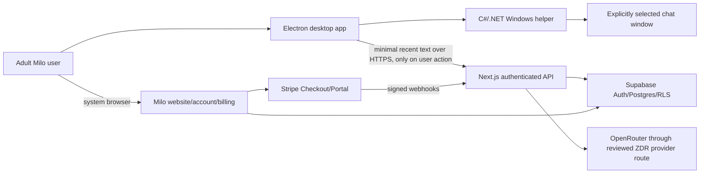

# Milo architecture freeze

Status: Approved architecture baseline; core Windows desktop path implemented locally, external release gates remain  
Last updated: 2026-08-30

## Purpose and scope

Milo will evolve from a screenshot-first Next.js SaaS into a Windows-first desktop companion without discarding the working website and backend. The web application remains the public website, account, authentication, billing, administration, and authenticated AI control plane. A packaged Electron application becomes the primary user experience. A small C#/.NET helper owns Windows-only accessibility and selected-window capture operations.

P0 is Windows only. macOS, Linux, a public developer API, automatic message sending, persistent conversation memory, cloud OCR as the normal desktop path, and general-purpose desktop automation are out of scope.

This document freezes the target boundaries and migration. The current worktree implements the monorepo foundation, secure Electron shell, stable selected-window identity, UIA-first extraction, selected-window capture and local OCR fallback, bounded local context/privacy preview, explicit suggestion trigger, desktop PKCE session, text-only suggestion API, and fixed-origin account/billing handoff. External service configuration, staging evidence, signing, updater publication, and beta release remain gated.

## Current repository architecture

The repository now uses a pnpm workspace with a web control plane, shared packages, and a Windows-first Electron shell:

- Next.js 16.2 App Router and React 19 under `apps/web/src/app` and `apps/web/src/components`.
- Server-side Supabase clients, cookie-based authentication, MFA/TOTP assurance checks, and RLS-aware account pages under `apps/web/src/lib`.
- Screenshot upload, in-process image sanitization, Tesseract OCR, safety screening, OpenRouter inference, schema validation, and atomic usage completion in `apps/web/src/app/api/analyze/route.ts`.
- Stripe Checkout, Customer Portal, signed/idempotent webhooks, subscription synchronization, and deletion recovery in `apps/web/src/app/api/billing`, `apps/web/src/app/api/webhooks/stripe`, and `apps/web/src/lib`.
- Additive Supabase migrations, server-only lifecycle analytics, a service-role quota RPC, distributed rate limiting, MFA-aware RLS, and pgTAP tests under `supabase`.
- An Electron shell under `apps/desktop`, shared workspace packages under `packages`, native helper scaffolding under `native/windows`, and web/desktop tests and CI workflows.

The current primary data flow is:

```text
Browser screenshot
  -> Next.js multipart route
  -> in-memory Sharp sanitization
  -> server-side Tesseract OCR
  -> temporary transcript + optional context to OpenRouter
  -> strict JSON schema + Zod validation
  -> Postgres usage increment + persisted generated replies
  -> browser result cards
```

This flow remains a legacy web capability during migration. It is not the target desktop flow.

### Phase 0 repository evidence map (historical snapshot)

| Required audit surface | Authoritative files inspected | Current-state conclusion |
| --- | --- | --- |
| Package/runtime definition | `package.json`, `pnpm-lock.yaml`, `tsconfig.json`, `vitest.config.ts`, `playwright.config.ts` | One pnpm package; strict TypeScript; Node range begins at 20.19; no workspace or desktop/native toolchain exists. |
| Next.js application | `src/app/**`, `src/components/**`, `src/proxy.ts`, `next.config.ts` | App Router web SaaS with landing, magic-link/MFA auth, dashboard, account/billing, admin, legal, API, and security middleware surfaces. |
| Supabase schema and RLS | `supabase/config.toml`, all ten `supabase/migrations/*.sql`, `supabase/tests/database/milo_security.test.sql` | Auth/RLS, service-only quota completion, privacy-safe analytics, distributed rate limiting, billing reconciliation, and 49 declared pgTAP assertions already exist. OAuth server mode is currently disabled. |
| API routes | `src/app/api/analyze/route.ts`, `feedback/route.ts`, `events/route.ts`, `health/route.ts`, `account/delete/route.ts`, `billing/**`, `webhooks/stripe/route.ts` | The server boundary is reusable, but the screenshot-oriented analysis contract and reply persistence cannot be reused unchanged for the desktop privacy path. |
| OpenRouter integration | `src/lib/openrouter.ts`, `provider-prompt.ts`, `provider-output.ts`, `schemas.ts`, `safety.ts` and their tests | Server-only key handling, ZDR, data-collection denial, moderation, untrusted transcript serialization, strict schema and Zod validation exist; provider allowlisting and fallback/parameter enforcement are missing. |
| Stripe integration | `src/lib/stripe.ts`, `billing.ts`, `stripe-webhook.ts`, billing API routes and webhook tests | Checkout, Portal, signed raw-body webhooks, idempotency leases, event reconciliation and server-authoritative entitlements are reusable. Desktop billing remains a browser handoff. |
| Security headers/configuration | `next.config.ts`, `src/proxy.ts`, `src/lib/content-security-policy.ts`, `src/lib/http-security.ts`, `src/lib/env.ts` and boundary tests | Nonced CSP, HSTS outside development, frame denial, no-sniff, referrer/permissions policies and no-store API behavior exist for web; Electron needs an independent local-content CSP and process boundary. |
| Test and CI surface | 26 `*.test.ts` files, `e2e/**`, `scripts/**`, `.github/workflows/security.yml`, `codeql.yml`, `production-smoke.yml`, `.github/dependabot.yml` | Web/security coverage is substantial but currently has no desktop/native/Windows/package/signing coverage. CI cannot run remotely because no Git remote/repository is configured. |
| Operations and documentation | `README.md`, `SECURITY.md`, `.env.example` at `HEAD`, `vercel.json` | Setup and release gates describe the web SaaS. They require monorepo, desktop privacy, native dependencies, signing/update and support-matrix revisions. The working tree currently deletes `.env.example`. |

The evidence map records what was inspected; it is not a claim that every existing control is release-proven. The execution plan lists the verification that must be repeated after each migration phase.

## Reusable components

| Existing component | Reuse decision | Required adaptation |
| --- | --- | --- |
| Next.js public, login, account, billing, admin, privacy, and terms surfaces | Keep in `apps/web` | Add desktop authorization/consent and account handoff pages; update product copy when desktop becomes primary. |
| Supabase Auth, SSR cookie integration, user eligibility, and TOTP/AAL2 design | Keep | Add OAuth 2.1 public-client authorization-code + PKCE for desktop and bearer-token API authentication. |
| Supabase schema, RLS, usage periods, subscriptions, analytics, and rate limiter | Keep and migrate additively | Add content-free suggestion reservation/completion functions and desktop-safe event vocabulary. Do not weaken existing RLS. |
| Stripe Checkout, Portal, webhook signature verification, leases, and reconciliation | Keep | Desktop opens allowlisted HTTPS account flows in the system browser and refreshes server-derived entitlement. |
| OpenRouter client boundary, prompt-injection treatment, safety prompt, strict JSON schema, and Zod parsing | Extract shared pure contracts; keep provider client server-only | Add a reviewed provider allowlist, parameter support requirement, disabled unrestricted fallback, and account/key guardrail release checks. |
| `analysisResultSchema`, tone/stage/category contracts | Move to `packages/contracts` | Add desktop request, entitlement, IPC, native-helper, and telemetry contracts. |
| Pure prompt serialization, provider output normalization, and deterministic safety checks | Move to `packages/ai` or `packages/security` | Remove screenshot-specific naming and keep all conversation data explicitly untrusted. |
| Existing Milo cat SVG and indigo/editorial visual language | Reuse as reference | Build desktop-specific stateful character and compact panel; do not reuse the web dashboard layout as the desktop shell. |
| Web tests and CI | Preserve | Move paths into workspace-aware jobs and add Windows/native/packaging jobs. |
| Current Tesseract.js OCR | Keep for the legacy web path | Desktop OCR runs locally in the Windows helper; bundle English and Italian fallback data. |

## Missing components

The repository now contains the Electron application, preload boundary, desktop renderer, selected-window picker, integrated native helper, UI Automation and selected-window capture/OCR paths, context normalizer and privacy preview, PKCE/safeStorage desktop session, bearer desktop API, content-free quota path, deterministic Windows fixture, unsigned installer, and local release verification. Production service configuration, interactive/staging evidence, signing, update channel, and public beta release remain future gates.

## Target system context



### Trust boundaries

1. The selected third-party chat window is untrusted input.
2. The .NET helper is privileged local code and may inspect only the explicitly selected top-level window.
3. The Electron renderer is sandboxed and untrusted relative to the main process.
4. The Electron main process owns authentication credentials, HTTPS calls, local settings, native-helper lifecycle, and clipboard writes.
5. The Next.js API is the only AI/provider boundary.
6. Supabase service credentials, Stripe secrets, and OpenRouter keys exist only in the web/server deployment.
7. OpenRouter and the selected downstream provider receive only the smallest text excerpt after the user asks Milo.

## Normal desktop data flow

```text
User selects a visible top-level window
  -> native helper validates HWND + PID + process start identity
  -> UI Automation reads only that window's bounded subtree
  -> if structured text is insufficient:
       Windows.Graphics.Capture targets that same HWND
       -> local OCR in the helper
       -> frame is disposed locally
  -> helper returns normalized text candidates, never pixels
  -> Electron main-process context engine keeps an ephemeral recent-message ring
  -> local change hash updates Milo's visual state; no AI request occurs
  -> user clicks Milo or presses the configured hotkey
  -> optional context preview/removal of names/recent-message limit
  -> bearer-authenticated POST /api/v1/suggest
  -> rate limit + content-free quota reservation
  -> safety checks + OpenRouter request + schema validation
  -> content-free quota completion and metadata-only analytics
  -> three replies returned to desktop memory
  -> user explicitly copies one reply
```

Screenshots, OCR frames, raw transcript text, participant names, and generated reply text are absent from cloud persistence and telemetry. The renderer never receives provider, Stripe, or Supabase refresh credentials.

## Desktop process architecture

### Electron main process

The main process owns:

- creation and positioning of the transparent overlay and compact settings/onboarding windows;
- native-helper startup, request correlation, timeout, restart, and shutdown;
- selected-window identity and the ephemeral context engine;
- PKCE verifier/state generation, loopback callback, token exchange, refresh, logout, and safeStorage;
- authenticated `/api/v1/*` calls;
- allowlisted system-browser account/billing links;
- global hotkey registration;
- reply copying without reading the existing clipboard;
- metadata-only telemetry dispatch.

The main process must not render remote pages. Renderer assets are packaged locally and loaded through an application protocol with a strict CSP.

### Preload boundary

The preload is typed and narrow. The initial API is limited to domain operations:

```ts
type MiloDesktopApi = {
  selectWindow(): Promise<SelectedWindowSummary | null>;
  pauseWatching(paused: boolean): Promise<WatchingState>;
  askMilo(input: AskMiloInput): Promise<SuggestionResponse>;
  copyReply(input: CopyReplyInput): Promise<void>;
  getSettings(): Promise<PublicSettings>;
  updateSettings(input: PublicSettingsPatch): Promise<PublicSettings>;
  openAccount(destination: "account" | "billing" | "privacy" | "terms"): Promise<void>;
  signIn(): Promise<AuthSummary>;
  signOut(): Promise<void>;
  onStateChanged(listener: (state: DesktopState) => void): () => void;
};
```

There is no generic IPC, file, shell, process, network, token, clipboard-read, URL, or Electron API. Every payload is schema-validated in preload and again in main. Every IPC handler checks the expected `webContents`, top frame, and local application origin.

Required BrowserWindow settings are explicit even when Electron defaults match them:

```text
nodeIntegration = false
contextIsolation = true
sandbox = true
webSecurity = true
webviewTag = false
navigateOnDragDrop = false
```

Navigation, new windows, permissions, and external URLs are denied by default. Packaging enables restrictive Electron fuses after verifying the current Electron release's supported fuse names.

### Desktop renderer

The renderer contains only presentation and state coordination:

- `cat`: idle, noticed, generating, ready, paused, error/offline states;
- `suggestions`: three large reply cards, short context summary, copy confirmation, retry;
- `onboarding`: meet Milo, choose window, privacy explanation, ready/hotkey;
- `settings`: general, privacy, account, about;
- reusable design tokens and accessible controls.

The overlay is non-focus-stealing while idle. It becomes keyboard-focusable only for deliberate interaction. Monitor work-area bounds determine panel opening direction and position clamping. Reduced motion, high contrast, scalable text, keyboard control, and 100%-200% DPI are release gates.

### Windows native helper

`Milo.Native.Windows` is a .NET 10 LTS `net10.0-windows` helper shipped as a signed, self-contained x64 binary for P0. It runs unelevated and has no network listener.

Electron starts the exact packaged binary with hidden windows and communicates over bounded, line-delimited JSON on inherited stdin/stdout. The protocol permits only:

- list eligible visible top-level windows;
- bind or clear one selected window;
- validate the selected window identity;
- extract accessibility text from that window;
- capture and OCR that window;
- start/stop bounded change observation;
- report capability and health metadata.

The helper rejects unknown commands, oversized messages, invalid identifiers, reused HWNDs, Milo-owned windows, invisible/cloaked/system windows, cross-session targets, and targets whose PID/process-start identity changed. It never accepts file paths, shell commands, screen coordinates for arbitrary capture, or arbitrary process IDs from the renderer.

Microsoft UI Automation is the primary extraction path. Traversal is rooted at the selected HWND and uses bounded content/control views plus read-only text/name/value patterns. Milo does not invoke, focus, type into, or mutate target controls. Elevated targets are unsupported in P0; Milo does not request elevation or `uiAccess` as a workaround.

If accessibility text is insufficient, `Windows.Graphics.Capture` creates a capture item for the validated selected HWND rather than capturing the desktop. OCR remains local. The preferred path is Windows local OCR when language support is present, with a pinned Tesseract 5 fallback and bundled English/Italian trained data. Frames and OCR intermediates are disposed immediately and never cross the helper boundary as pixels.

## Local context engine

The context engine runs in Electron's main process, not the renderer. Its defaults are:

- selected-window scope only;
- ephemeral memory only;
- last 8 normalized messages;
- bounded total text size, initially 4,000 Unicode characters;
- participant-name removal enabled by default when reliable labels are detected;
- duplicate and change detection using in-memory hashes;
- debounce for extraction churn;
- no network request until an explicit click or hotkey;
- clear context on Pause, Change Window, window close, logout, or application exit.

Per-application adapters may improve speaker ordering, but the generic path must preserve uncertainty rather than invent speakers. Persisted settings may include theme, hotkey, animation level, recent-message limit, name-removal preference, and overlay position. P0 does not persist a conversation transcript, OCR result, selected window title, PID, HWND, participant name, reply, or clipboard content.

## Authentication architecture

Supabase OAuth 2.1 Server is the preferred desktop authorization authority because it issues standard Supabase tokens to public desktop clients using authorization code + PKCE.

1. Register separate public OAuth clients for LOCAL, CI, STAGING, and PRODUCTION.
2. Use an exact loopback callback such as `http://127.0.0.1:43821/oauth/callback` for the native client. The listener binds only loopback, exists only during sign-in, verifies state, and closes after one response.
3. Electron main generates a high-entropy verifier, S256 challenge, and state, then opens the Supabase authorization endpoint in the system browser.
4. Supabase redirects to the Milo web `/oauth/consent` UI. Existing web login, adult eligibility, and MFA step-up are reused before approval.
5. The desktop exchanges the single-use code directly at Supabase's token endpoint as a public client; it accepts any successful 2xx response rather than hard-coding 201.
6. The access token is memory-only. The refresh token is encrypted with Electron `safeStorage` and stored as ciphertext in the app user-data directory. If encryption is unavailable, sign-in fails closed.
7. The renderer sees only a non-sensitive authentication summary.
8. Logout revokes/signs out the session, clears ciphertext, access tokens, selected window, context, and replies.

The web API validates every bearer token against Supabase, verifies the registered desktop `client_id`, adult eligibility, and required MFA assurance. Cookie authentication remains for the website. Desktop code contains a public Supabase URL, publishable key if required by the chosen SDK path, public OAuth client ID, and Milo API origin only; these are identifiers, not secrets.

OAuth scopes do not authorize Milo operations by themselves. Server-side entitlement and route authorization remain authoritative, and RLS remains defense in depth.

## Suggestion API architecture

### Endpoint

`POST /api/v1/suggest` is an authenticated, text-only endpoint for Milo first-party clients. It is not a public developer API.

Initial request contract:

```json
{
  "requestId": "uuid",
  "messages": [
    { "speaker": "self|other|unknown", "text": "bounded normalized text" }
  ],
  "tone": "warm|confident|playful|direct",
  "relationshipStage": "new_match|first_dates|dating|relationship|conflict",
  "detectedLanguage": "optional BCP-47 hint",
  "extractionMethod": "uia|local_ocr",
  "client": { "platform": "windows", "version": "semver" }
}
```

The server enforces message count, per-message and aggregate length, Unicode/control-character normalization, enum values, request UUID, supported client, and content type. Participant names are not part of the contract.

Response reuses the strict three-reply contract. Unsafe input returns a safety response with empty ordinary replies. The endpoint has no model tools and no browser, shell, clipboard, messaging, file, or OS capability.

### Quota without content persistence

The existing `complete_analysis` function atomically stores replies and consumes usage. It cannot satisfy the desktop privacy invariant unchanged.

Add an additive metadata-only request record or extend `analyses` with a source/client-request identifier, then add two trusted service-role functions:

- `reserve_suggestion`: lock the user's entitlement period, reject exhausted allowance, reject a second live request, and create a bounded pending metadata row without storing text.
- `complete_suggestion`: recheck the same entitlement period, increment usage once, record model/token/cost/status metadata, and never accept or write reply text.

Failed or safety-blocked provider calls do not consume usage. A stale pending reservation is reclaimable after a bounded lease. A unique `(user_id, client_request_id)` constraint prevents accidental duplicate model spending. Because generated content is not stored, a network failure after successful completion may consume usage without allowing the client to recover the reply; this unavoidable trade-off must be explained and measured rather than solved by silently persisting content.

The legacy web `/api/analyze` remains separate until product review decides whether to retire screenshot coaching. Desktop never uploads a screenshot to it.

### OpenRouter boundary

The provider request remains server-only and must include all of:

- exact reviewed model identifier;
- exact reviewed provider `only` allowlist;
- unrestricted fallback disabled;
- required-parameter support enabled;
- data collection denied;
- ZDR required;
- strict response JSON schema;
- no tools;
- bounded prompt and output;
- separate OpenRouter key/guardrail for each environment with model/provider allowlists and spend limits.

Conversation content is serialized as untrusted data and cannot change system instructions. Model and moderation-provider retention behavior must be reviewed together before launch.

## Data classification and persistence

| Data | Location | Persistence |
| --- | --- | --- |
| Selected-window pixels | Native helper memory | Never persisted; disposed after local OCR. |
| UIA/OCR transcript | Helper and Electron main memory | Ephemeral; cleared on lifecycle events. |
| Context hashes | Electron main memory | Ephemeral and non-reversible for product purposes. |
| Access token | Electron main memory | Session only. |
| Refresh token | Electron safeStorage ciphertext | Local OS-protected persistence. |
| User settings and overlay position | Local settings store | Persistent; content-free. |
| Minimal submitted text | TLS request, Next.js/OpenRouter memory | No Milo database or log persistence. |
| Generated replies | Provider/API/desktop memory | No Milo cloud persistence by default. |
| Request/usage/model/cost metadata | Supabase | Persistent, content-free. |
| Subscription/customer identifiers | Supabase/Stripe | Persistent, server-controlled. |
| Product telemetry | Supabase | Fixed vocabulary and content-free properties only. |

## Exact monorepo migration

The migration uses `git mv` in small commits to preserve history. pnpm workspaces are sufficient; Turborepo, Nx, microservices, Redis, queues, and containers are not added without a measured need.

| Current path | Target path | Notes |
| --- | --- | --- |
| `src/app`, `src/components`, web-only `src/lib`, `src/proxy.ts`, `src/types` | `apps/web/src/...` | Preserve App Router behavior and aliases. |
| Root `package.json` | `apps/web/package.json` plus a new root orchestration `package.json` | Web runtime dependencies move to the web package; root owns workspace scripts/tooling only. |
| `pnpm-lock.yaml`, `pnpm-workspace.yaml` | Remain at repository root | Keep one lockfile; add explicit `apps/*` and `packages/*` workspace globs while preserving reviewed build-dependency policy and overrides. |
| `next.config.ts`, `postcss.config.mjs`, `vercel.json` | `apps/web/` | Vercel root directory becomes `apps/web`; deployment docs and smoke scripts must reflect it. |
| `tsconfig.json`, `eslint.config.mjs`, `vitest.config.ts`, `vitest.setup.ts` | app-specific configs in `apps/web`, shared base configs at root only where useful | Do not make desktop inherit DOM/server types accidentally. |
| `e2e`, `e2e-production`, Playwright configs | `e2e/web`, with workspace-aware configs | Preserve existing tests before adding `e2e/desktop`. |
| `scripts/local-preview.mjs`, OpenRouter smoke | `apps/web/scripts/` | Keep web-local behavior. |
| Release readiness and production smoke scripts | root `scripts/` | Rewrite paths for monorepo and check desktop/native artifacts. |
| `src/lib/schemas.ts` pure DTO schemas | `packages/contracts/src` | Split browser form-only schemas back into `apps/web` if they are not shared. |
| `src/lib/provider-prompt.ts`, `provider-output.ts`, reusable safety prompt/rules | `packages/ai/src` and `packages/security/src` | Provider client and secrets stay in `apps/web`; packages remain secret-free. |
| Synthetic fixtures currently embedded in tests/demo | `packages/test-fixtures` | No real conversations. Add English/Italian and adversarial fixtures. |
| `supabase` | Remains at repository root | Migration history must not be rewritten. Add only new migrations. |
| `.github` | Remains at repository root | Update paths and add Windows jobs/release workflow. |
| `design-system/milo/MASTER.md` | `apps/web/design-system/milo/MASTER.md` | It documents the website. Desktop UI direction is documented separately. |
| Root `AGENTS.md` | `apps/web/AGENTS.md` plus a new monorepo root `AGENTS.md` | Keep Next.js-specific rules scoped to the web app. |
| Root `CLAUDE.md` | Remains at repository root | Continue pointing to the root instruction file; add app-local references only if required by tooling. |
| Root `.gitignore` | Remains at repository root | Make generated paths workspace-aware and explicitly ignore desktop/native build, package, signing-temporary, test, and crash artifacts without hiding required manifests or examples. |
| Root `README.md` and `SECURITY.md` | Remain root and become product-wide | Link app-specific setup and the security invariants. |
| `.env.example` | `apps/web/.env.example`; optional root index of variable names | Desktop public config gets a separate example with no secret placeholders. |

Proposed P0 tree:

```text
milo/
  apps/
    web/
      src/
      scripts/
      design-system/
      package.json
      next.config.ts
      vercel.json
    desktop/
      src/
        main/
          auth/
          ipc/
          native/
          updates/
          windows/
        preload/
        renderer/
          cat/
          components/
          onboarding/
          settings/
          suggestions/
      assets/
      forge.config.ts
      package.json
  native/
    windows/
      Milo.Native.Windows/
        Accessibility/
        Capture/
        Ocr/
        Protocol/
      Milo.Native.Windows.Tests/
      Milo.TestChat/
      Milo.Native.Windows.sln
  packages/
    ai/
    contracts/
    security/
    test-fixtures/
  supabase/
  e2e/
    web/
    desktop/
  docs/
    ARCHITECTURE.md
    SECURITY-INVARIANTS.md
    exec-plans/active/windows-p0.md
  scripts/
  .github/workflows/
  package.json
  pnpm-workspace.yaml
  pnpm-lock.yaml
  tsconfig.base.json
  global.json
```

`native/windows/macos` is not created; the reserved future path is `native/macos/` and remains outside P0.

## Dependency changes

Versions are selected and pinned during the relevant implementation phase after checking current releases and advisories.

### Root/toolchain

- Change Node certification from `>=20.19.0`/CI Node 20 to Node 24 LTS, pin with `.node-version` or Volta and CI.
- Add .NET 10 LTS via `global.json`; the current machine has only .NET 9.
- Add workspace packages to `pnpm-workspace.yaml`.
- Keep one committed pnpm lockfile and frozen installs.

### Desktop

- `electron` and Electron Forge core/CLI.
- Forge Vite plugin, Squirrel.Windows maker for the first beta, and fuses plugin plus `@electron/fuses`.
- React, React DOM, TypeScript, Vite, Zod, and the shared workspace packages.
- Playwright Electron support and an accessibility test utility such as axe for renderer surfaces.
- No native Node module is allowed in the renderer.

### Native Windows

- .NET 10 Windows desktop/reference packs.
- Windows SDK/WinRT projection required for `Windows.Graphics.Capture` and local OCR.
- A pinned Tesseract 5-compatible .NET binding and redistributable/native dependencies only after a license, signing, size, and sandbox review.
- Bundled `eng` and `ita` trained data with checksums and license notices.

### Web

- Keep current Next.js, Supabase, Stripe, OpenRouter, Sharp, and Tesseract dependencies through the behavior-preserving migration.
- Later remove web screenshot/OCR dependencies only if the legacy web analysis product is explicitly retired.

## Architecture decisions requiring review

1. **Desktop authentication:** use Supabase OAuth 2.1 Server public client + PKCE and a fixed loopback redirect. Supabase documents this use for desktop applications, but production enablement, asymmetric signing keys, client registration, MFA/AAL behavior, and exact callback handling require a Phase 7 spike.
2. **Installer:** use stable Squirrel.Windows for the first x64 beta; treat experimental MSIX as a later option.
3. **Windows support baseline:** certify Windows 11 x64 first; test Windows 10 22H2 x64 where the chosen Electron/.NET/native dependencies still support it. ARM64 is not a P0 release target unless explicitly added.
4. **OCR:** keep pixels inside the native helper and prefer local Windows OCR with Tesseract 5 fallback. The exact binding is not frozen until Phase 4 proves packaging and accuracy.
5. **Legacy web analysis:** preserve it during monorepo migration. Product/legal review must decide whether its persisted replies remain acceptable after the desktop privacy policy becomes primary.
6. **Updates:** define stable and beta feeds in Phase 12 after a GitHub repository and artifact host exist. No updater may install unsigned or unverified artifacts.

## Authoritative references

- Electron security checklist: https://www.electronjs.org/docs/latest/tutorial/security
- Electron context isolation: https://www.electronjs.org/docs/latest/tutorial/context-isolation
- Electron sandboxing: https://www.electronjs.org/docs/latest/tutorial/sandbox
- Electron Forge Windows signing: https://www.electronforge.io/guides/code-signing/code-signing-windows
- Supabase OAuth 2.1 server: https://supabase.com/docs/guides/auth/oauth-server
- Supabase OAuth flows: https://supabase.com/docs/guides/auth/oauth-server/oauth-flows
- Supabase OAuth token security/RLS: https://supabase.com/docs/guides/auth/oauth-server/token-security
- Windows UI Automation specification: https://learn.microsoft.com/en-us/windows/win32/winauto/ui-automation-specification
- Windows screen capture: https://learn.microsoft.com/en-us/windows/apps/develop/media-authoring-processing/screen-capture
- Selected-window capture interop: https://learn.microsoft.com/en-us/windows/win32/api/windows.graphics.capture.interop/nf-windows-graphics-capture-interop-igraphicscaptureiteminterop-createforwindow
- .NET release support: https://learn.microsoft.com/en-us/dotnet/core/releases-and-support
- OpenRouter provider routing: https://openrouter.ai/docs/guides/routing/provider-selection
- OpenRouter ZDR: https://openrouter.ai/docs/guides/features/zdr
