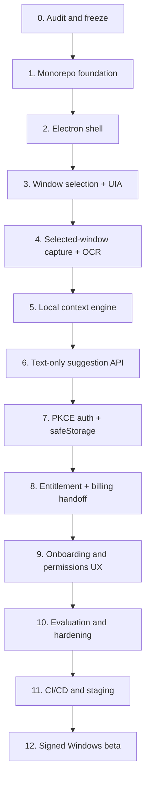

# Windows P0 execution plan

Status: Phases 0-8 core implementation complete locally; Phase 9-10 hardening is partial; external staging, signing, updater, and beta release gates remain  
Owner: Milo engineering  
Last updated: 2026-08-30

## Implementation checkpoint — 2026-08-30

The current worktree has completed the secure desktop shell, stable selected-window identity, UIA-first extraction, selected-window WGC/local OCR fallback, local context engine and privacy preview, explicit click/hotkey suggestion path, text-only authenticated backend, PKCE/safeStorage desktop session, and fixed-origin account/billing handoff. The real UIA, English OCR, Electron shell, production build, unit/security, Forge packaging, artifact-scan, and packaged-launch gates pass locally.

Remaining work is environment/release focused: live Supabase/Stripe/OpenRouter/SMTP configuration and lifecycle tests, an Italian OCR capability decision for hosts without that Windows language pack, combined interactive desktop automation, clean remote CI/database evidence, legal/security review, Authenticode signing, updater publication, and staged beta validation. Completed phases must not be rebuilt unless a regression is found.

## Objective

Deliver a privacy-first, signed Windows beta in which a small floating Milo cat observes only a user-selected chat window, extracts text locally through UI Automation or selected-window capture plus local OCR, sends minimal text to Milo's authenticated backend only after an explicit user action, returns exactly three safe structured suggestions, and never sends a message automatically.

The existing Next.js/Supabase/Stripe/OpenRouter application remains the web and cloud control plane. Work proceeds in the numbered order below. Major implementation does not begin until the Phase 0 documents are reviewed.

## Non-goals

- macOS or Linux clients;
- public developer API;
- persistent conversation memory;
- cloud OCR in the normal desktop flow;
- whole-desktop surveillance;
- automatic paste/send or arbitrary desktop automation;
- embedding payment-card collection in Electron;
- Kubernetes, Kafka, RabbitMQ, speculative microservices, or Redis without measured need.

## Phase 0 audit evidence

### Repository state

- Branch: `codex/milo-release`.
- Commits: `94fec7b` and `34f51ab`.
- No Git remote is configured.
- The worktree was already dirty before Phase 0 documentation: tracked `.env.example` deleted; `deepseekspro.json` and preview logs untracked.
- `deepseekspro.json` contains plaintext provider credentials. Rotation and secure removal are mandatory before publication.

### Current product and controls

- 97 first-party files under `src`; 26 Vitest files.
- Next.js 16.2.12, React 19.2.8, strict TypeScript, Tailwind 4.
- Screenshot upload is bounded, signature/format/dimension checked, metadata-stripped, and kept in memory.
- Tesseract.js OCR runs server-side and currently bundles English only.
- OpenRouter uses a pinned DeepSeek model, moderation plugin, ZDR, data-collection denial, strict provider JSON schema, Zod validation, and untrusted transcript serialization.
- OpenRouter has no explicit provider allowlist, no disabled unrestricted fallback, and no required-parameter gate.
- Supabase supports cookie auth, server-side validation, adult app-metadata eligibility, TOTP/AAL2, RLS, service-role writes, HMACed distributed rate limiting, and atomic quota completion.
- Ten migrations define profiles, subscriptions, analyses, persisted replies, feedback, usage periods, content-free analytics, Stripe event receipts, MFA policies, rate limiting, and admin aggregate metrics.
- The pgTAP file declares 49 assertions covering grants, RLS, free/paid quotas, rollover, and ownership.
- Stripe Checkout, Portal, signed raw-body webhook validation, retry leases, duplicate/reordered event handling, customer recovery, and deletion saga are implemented.
- Security headers include CSP nonces, HSTS outside development, frame denial, no-sniff, strict referrer, permissions policy, and private/no-store API responses.
- Web CI covers frozen install, production audit, typecheck, lint, Vitest, build, mocked Playwright, optimized production public Playwright, Supabase reset/pgTAP, Dependabot, CodeQL, and scheduled public smoke.

### Baseline verification on 2026-08-20

| Check | Result | Evidence/limitation |
| --- | --- | --- |
| `pnpm typecheck` | Pass | Exit 0. |
| `pnpm lint` | Pass | Exit 0. |
| `pnpm test` | Pass | 126 tests passed across web and shared packages; exit 0. |
| `pnpm build` | Pass | Next.js optimized production build completed; exit 0. |
| Mocked Playwright | Pass | Eight desktop/mobile tests, including the complete 360px lifecycle; exit 0. |
| Production Playwright | Pass | Six optimized-build desktop/mobile tests; exit 0. |
| Production dependency audit | Pass | `pnpm audit --prod --audit-level moderate`; no known vulnerabilities after pinning `nanoid` 3.3.18. |
| Node | Repository pinned; host not target-aligned | `.node-version` pins Node 24.19.0 and CI consumes it. Local Codex host remains Node 26.4.0, so a clean Node 24 runner is still required. |
| .NET | Repository pinned; host not target-aligned | `global.json` pins .NET SDK 10.0.302. This host does not have that SDK yet. |
| Docker/Supabase CLI/GitHub CLI | Missing locally | Database reset, local pgTAP, and GitHub CI cannot be reproduced from this machine yet. |
| Production credentials | Incomplete | Public Supabase and OpenRouter variables present; server Supabase, rate-limit, Stripe, and admin variables absent. |

This table is a baseline, not a release claim. Existing historical test artifacts are not sufficient after the architecture change.

## Dependency order



Security, privacy, accessibility, and performance tests are added in each phase rather than deferred entirely to Phase 10.

## Phase 0 - Repository audit and architecture freeze

### Deliverables

- [x] `docs/ARCHITECTURE.md`
- [x] `docs/SECURITY-INVARIANTS.md`
- [x] `docs/exec-plans/active/windows-p0.md`
- [x] `docs/decisions/0001-windows-p0-architecture.md` approval record.
- [x] Current file-to-workspace migration map.
- [x] Reusable/missing component inventory.
- [x] Security/privacy gap list.
- [x] Dependency, test, risk, and release ordering.
- [x] Product/security review approved ADR 0001 without amendments on 2026-08-20.

### Acceptance criteria

- The plan maps current files rather than assuming an empty repository.
- The desktop/cloud/native trust boundaries and normal data flow are explicit.
- Every numbered implementation phase has changes, security implications, tests, and evidence gates.
- Conflicts with current behavior are documented, especially persisted web replies and desktop no-persistence.
- No major app behavior is changed before review.

### Review questions

1. Approve Supabase OAuth 2.1 public client + fixed loopback PKCE callback for desktop?
2. Approve x64-first signed beta and Squirrel.Windows as the initial installer?
3. Approve preserving the screenshot web coach as a legacy capability during migration?
4. Approve no persistence of selected window identity or conversation content in P0?
5. Approve Windows local OCR with a bundled Tesseract 5 English/Italian fallback, subject to Phase 4 packaging validation?
6. Approve Windows 11 x64-first certification, with Windows 10 22H2 support conditional on measured dependency and real-machine evidence?

Replying `Approve ADR 0001` accepts all six proposed decisions. Any decision may instead be amended individually in `docs/decisions/0001-windows-p0-architecture.md` before Phase 1 starts.

## Phase 1 - Monorepo foundation

### Intended outcome

Convert the repository to pnpm workspaces without changing public web behavior.

### Changes

1. Rotate/revoke exposed provider credentials, securely remove `deepseekspro.json`, inspect history/artifacts, and enable secret scanning before any push.
2. Resolve the pre-existing `.env.example` deletion and preview-log files intentionally.
3. Pin Node 24 LTS for local/CI/Vercel tooling and .NET 10 LTS in `global.json`.
4. Create a root orchestration `package.json`, workspace globs, base TS config, and the directory tree from `docs/ARCHITECTURE.md`.
5. Use `git mv` to relocate the current Next.js app to `apps/web` in reviewable commits.
6. Move pure contracts to `packages/contracts`; move only proven reusable pure AI/security helpers afterward.
7. Update path aliases, scripts, Vercel root, Playwright paths, release scripts, CI, README, SECURITY, and scoped AGENTS rules.
8. Do not add Electron/native feature behavior yet.

### Security/privacy implications

- A bad move can expose `.env.local`, break server-only imports, weaken CSP/proxy behavior, or accidentally publish test bypasses.
- Root and web package boundaries must prevent server-only modules from entering future desktop bundles.
- Existing migration history remains untouched.

### Acceptance criteria

- Clean checkout installs with `pnpm install --frozen-lockfile` on Node 24.
- `apps/web` behavior, headers, protected routes, auth, billing, analysis, and demo remain unchanged.
- No production capability or security control is deleted.
- Workspace dependency graph has no cycle and desktop/shared packages cannot import web server secrets.

### Tests/evidence

- production dependency audit;
- root and web typecheck/lint;
- all existing Vitest tests with no unhandled worker errors;
- 49-assertion local pgTAP suite;
- existing mocked and optimized production Playwright suites;
- web production build on Node 24;
- bundle/static scan for secret variable names/values and `MILO_E2E_MODE` rejection;
- `git diff --check` and migration checksum/order parity.

Estimated effort: 3-5 engineering days after toolchain and key rotation are available.

### Phase 1 progress recorded 2026-08-20

- Completed the behavior-preserving `apps/web` move and root pnpm workspace orchestration.
- Extracted pure schemas, provider prompt/output handling, and deterministic safety helpers into `packages/contracts`, `packages/ai`, and `packages/security`; added a synthetic-only `packages/test-fixtures` boundary.
- Updated TypeScript, ESLint, Vitest, Playwright, Vercel, release-script, CI, README, SECURITY, and scoped AGENTS paths.
- Reproduced the workspace with pnpm 10.34.5 and `--frozen-lockfile`; typecheck, lint, 126 unit tests, production build, eight mocked browser tests, six production browser tests, release/smoke contracts, and the production dependency audit pass.
- Remaining Phase 1 gates are external or environment-specific: rotate/remove the exposed scratch credentials before any push, run the 49-assertion pgTAP suite through a Docker-capable clean checkout, prove the same gates on Node 24, and validate a Vercel Preview with Root Directory `apps/web` plus outside-root workspace sources enabled.

## Phase 2 - Electron Milo shell

### User flow

Launch Milo -> see a small floating cat -> drag it beside a chat -> open/collapse the compact suggestion/settings surfaces -> pause/resume -> quit.

### Changes

- Scaffold `apps/desktop` with Electron Forge, Vite, React, strict TypeScript, local packaged renderer assets, and shared contracts.
- Implement secure BrowserWindow defaults, global sandbox, CSP, navigation/permission denial, fuses configuration, and typed preload.
- Implement cat state machine: idle, noticed, generating, ready, paused, error/offline.
- Implement drag/reposition, work-area clamping, per-display content-free position settings, light/dark/high-contrast/reduced-motion handling, and compact menu.
- Keep the native and API functions as typed unavailable states; no fake production access.

### Security/privacy implications

- Renderer compromise must not provide Node, Electron, token, filesystem, shell, arbitrary network, or native command access.
- Position/settings persistence must be content-free.

### Acceptance criteria

- Milo remains always on top beside another app without unnecessary focus stealing.
- All visible states are distinguishable without relying on color.
- Panel remains within the current monitor work area at 100%-200% DPI.
- Keyboard and screen-reader paths exist for every mouse action.

### Tests/evidence

- unit tests for state machine, position/clamp logic, settings schema, and reduced motion;
- Electron integration assertions for BrowserWindow settings, CSP, no webview, navigation/new-window/permission denial, and IPC sender validation;
- preload surface snapshot/allowlist test proving no generic methods;
- Playwright Electron keyboard/focus/a11y tests;
- real Windows smoke on 1080p/1440p/4K and 100/125/150/175/200% scaling;
- multi-monitor unplug/replug and sleep/resume smoke;
- no Electron security warnings.

Estimated effort: 1-2 engineering weeks.

## Phase 3 - Selected-window identification and UI Automation

### User flow

Choose window -> see only eligible visible applications -> select one -> Milo shows `Watching: <application>` -> readable synthetic chat text appears in a local preview -> pause/change stops the old observation.

### Changes

- Create .NET 10 helper solution and bounded stdin/stdout protocol.
- Enumerate eligible top-level windows and create opaque selection identities.
- Validate HWND, PID, process creation identity, session, visibility, ownership, and handle reuse before each operation.
- Implement read-only UI Automation traversal rooted at the selected window using bounded content/control views and text/name/value patterns.
- Add selected-subtree change observation with debounce; detection updates local state only.
- Build `Milo.TestChat` with a deterministic accessible conversation surface.

### Security/privacy implications

- No arbitrary PID/HWND from the renderer, whole-desktop tree crawl, elevated access, focus/control invocation, or text logging.
- Selection is cleared when identity changes or the target closes.

### Acceptance criteria

- Accessible synthetic chat produces ordered conversation text without any capture/OCR.
- Unselected windows are never traversed after selection.
- Elevated/inaccessible targets fail with a user-safe message; Milo remains unelevated.

### Tests/evidence

- C# unit tests for protocol parsing/limits, window validation, HWND reuse, exclusion rules, and traversal bounds;
- synthetic accessible-chat integration test with alternating speakers, emoji, multiline messages, and Italian text;
- negative tests for unselected, closed, minimized, cloaked, Milo-owned, system, cross-session, and elevated windows;
- process crash/restart and timeout tests;
- content-free native logs assertion;
- real app exploratory matrix recorded without yet claiming official support.

Estimated effort: 2-3 engineering weeks.

## Phase 4 - Selected-window capture and local OCR

### User flow

When UI Automation cannot read the selected chat, Milo locally uses that same selected window's image, shows a brief local-reading state, and produces a text preview without uploading pixels.

### Changes

- Create `Windows.Graphics.Capture` item for the validated selected HWND.
- Capture the smallest useful current frame, never the whole desktop.
- Run OCR away from Electron UI threads inside the helper.
- Prefer installed Windows local OCR when supported; add a pinned Tesseract 5 fallback with bundled `eng` and `ita` data.
- Normalize orientation/DPI/color safely and dispose all frames/intermediates.
- Add inaccessible/owner-drawn mode to `Milo.TestChat` plus English/Italian golden fixtures.

### Security/privacy implications

- Pixels never cross into renderer, HTTP, provider, analytics, database, error monitoring, or production logs.
- Protected/black frames, capture denial, and language absence fail closed.

### Acceptance criteria

- The inaccessible synthetic fixture reconstructs useful ordered text locally in English and Italian.
- A network interceptor proves no image request occurs.
- UI remains responsive while OCR runs and cancellation works immediately on Pause/Change Window.

### Tests/evidence

- native capture target identity tests and assertion that display/rectangle capture commands do not exist;
- English/Italian OCR corpus with character error rate, word error rate, emoji preservation, speaker ordering, and message boundaries;
- malformed, huge, transparent, high-DPI, dark-mode, protected/black, resized, closed-mid-capture, and rapid-change fixtures;
- latency, CPU, peak RAM, cancellation, and repeated-frame leak benchmark;
- helper output/log scan proving no frame bytes/content;
- real Windows test on supported GPU/remote-session scenarios.

Estimated effort: 3-4 engineering weeks. Exact OCR dependency remains a spike gate.

## Phase 5 - Local context engine

### User flow

Milo notices meaningful new text locally -> subtle noticed state -> user may preview the last messages, remove names, change the message limit, or ask Milo. No AI call happens merely because the chat changed.

### Changes

- Normalize UIA/OCR results into speaker/message candidates with explicit uncertainty.
- Add ordering, boundary handling, duplicate suppression, diffing, debounce, max-size, recent-message, and name-removal policies.
- Keep context and hashes in main-process memory only.
- Clear context on all privacy lifecycle events.
- Add visible `Watching`, `Paused`, `Preview`, and `Change` behavior.

### Security/privacy implications

- No local disk transcript, renderer storage, analytics content, or automatic API call.
- Truncation is deterministic and preserves the newest useful turns.

### Acceptance criteria

- Meaningful changes update Milo's state without network traffic.
- Duplicate OCR/UIA scans do not create duplicate messages.
- Preview exactly matches the text later submitted.
- Names and old messages are removed according to settings.

### Tests/evidence

- property/unit tests for normalization, ordering, dedupe, diff, debounce, Unicode, emoji, malformed OCR, and all size boundaries;
- lifecycle tests for pause/change/close/logout/exit clear behavior;
- network spy asserting zero request on detection;
- renderer/main separation test asserting raw context never enters persisted settings;
- synthetic multilingual fixtures and fuzz cases.

Estimated effort: 1-2 engineering weeks.

## Phase 6 - User-triggered suggestion API

### User flow

Click Milo/hotkey -> immediate generating state -> minimal previewed text is sent -> three suggestions appear -> user edits/copies one -> no cloud content record remains.

### Changes

- Extract shared request/response/Zod/JSON schemas into `packages/contracts`.
- Add authenticated text-only `POST /api/v1/suggest` and a content-free entitlement endpoint.
- Add additive migration for request ID/source metadata plus `reserve_suggestion` and `complete_suggestion` service-role functions that never accept transcript/reply parameters.
- Adapt provider prompt to structured messages and add reviewed provider routing controls.
- Add desktop content-free analytics/event path.
- Integrate the desktop through production-disabled E2E identity during this phase only; Phase 7 adds real native auth.

### Security/privacy implications

- Reject images/multipart, unbounded text, participant-name fields, client-supplied identity/plan/model/provider, and model tools.
- No transcript or generated reply is persisted.
- Provider allowlist, disabled fallback, `requireParameters`, ZDR, collection denial, schema, and safety are mandatory.

### Acceptance criteria

- One explicit action against a supported synthetic fixture yields exactly three valid suggestions.
- Failed/unsafe requests do not consume usage; successful requests consume exactly one.
- No `replies` row, context field, analytics property, or log contains content.
- Concurrent/duplicate requests cannot overspend or bypass allowance.

### Tests/evidence

- contract tests shared by server and desktop;
- API tests for auth, media type/body limits, enums, Unicode, rate limit, reservation lease, quota exhaustion/rollover, duplicate UUID, provider timeout, malformed output, and database failure;
- database/pgTAP tests for function privileges, free/paid quotas, concurrency, no content parameters/columns, and RLS;
- prompt-injection and unsafe-content suite;
- OpenRouter request mock assertions for model/provider/privacy/tool fields;
- database/log/analytics scans after synthetic requests;
- click-to-suggestion latency instrumentation with content-free fields.

Estimated effort: 1-2 engineering weeks.

## Phase 7 - Desktop authentication and secure storage

### User flow

Sign in -> system browser opens Milo/Supabase authorization -> user authenticates and approves -> desktop receives session -> token refresh is silent -> MFA step-up appears when required -> logout clears all local state.

### Changes

- Enable Supabase OAuth 2.1 Server per environment and register a public desktop client.
- Add web `/oauth/consent` UI with login-destination preservation, eligibility, MFA, client details, and approve/deny.
- Implement main-process S256 PKCE, state, loopback listener, token exchange/refresh/revocation, and safeStorage ciphertext.
- Add bearer-aware API guard and expected desktop `client_id` validation while retaining web cookies.
- Add expired/revoked/offline session UX.

### Security/privacy implications

- No embedded privileged login WebView, desktop secret, renderer token, wildcard redirect, or plaintext refresh token.
- Supabase OAuth scopes do not replace route authorization/RLS.

### Acceptance criteria

- New and existing eligible accounts authenticate through the system browser.
- Enrolled MFA accounts cannot call protected APIs at AAL1.
- Restart refreshes from safeStorage without exposing tokens.
- Logout/revocation/expiry clears session, context, selection, and replies.

### Tests/evidence

- verifier/challenge/state entropy and replay/expiry/wrong-state tests;
- loopback host/port/path/method/one-shot/timeout tests;
- wrong client ID, redirect URI, authorization denial, token endpoint non-2xx, and 2xx status handling;
- safeStorage unavailable/corrupt ciphertext tests;
- renderer/IPC/log/bundle token absence tests;
- real Supabase LOCAL/STAGING magic-link + consent + MFA/AAL2 + refresh + logout lifecycle;
- OAuth-token RLS and desktop API authorization tests.

Estimated effort: 2-3 engineering weeks. Supabase OAuth public-client and AAL behavior are explicit spike gates.

## Phase 8 - Subscription and entitlement

### User flow

Desktop displays server usage/plan -> free limit produces a compact upgrade state -> system browser opens Milo's secure Checkout/account flow -> signed webhook updates access -> desktop refreshes entitlement -> Portal handles payment changes/cancellation.

### Changes

- Add desktop-safe entitlement response and refresh triggers.
- Map fixed `account`/`billing` destinations to exact HTTPS web URLs in main.
- Preserve existing Stripe Checkout/Portal/webhooks and browser controls.
- Add desktop states for free, active, past_due, unpaid, cancellation scheduled, exhausted, and unavailable.

### Security/privacy implications

- Desktop never sends or trusts subscription status and never receives Stripe secrets.
- Card collection remains entirely with Stripe.

### Acceptance criteria

- Free/paid allowances match server state.
- Payment failure does not leave the user without a Portal recovery path.
- Cancellation timing follows current Stripe subscription periods.

### Tests/evidence

- free, paid, renewal, cancellation, failed payment, recovery, duplicate/reordered webhook, wrong price/mode, and deleted customer tests;
- desktop wrong/fake plan values ignored;
- external URL allowlist tests;
- real Stripe test-mode Checkout -> webhook -> entitlement -> Portal -> cancel lifecycle in STAGING.

Estimated effort: 1-2 engineering weeks after production-like Stripe test configuration exists.

## Phase 9 - Permission and onboarding UX

### User flow

Meet Milo -> choose a chat -> understand local vs sent data -> configure hotkey -> start watching. Permission/capability explanations precede OS prompts. Empty/error states remain actionable.

### Changes

- Implement the four short onboarding steps from the product direction.
- Add privacy preview and settings groups: General, Privacy, Account, About.
- Add No chat, Chat closed, No readable conversation, Offline, Quota exhausted, and safe error states.
- Add upgrade/account handoff without interrupting the floating interaction.

### Security/privacy implications

- Copy must accurately distinguish data staying local from text sent on ask.
- No dark patterns, automatic selection, hidden monitoring, or misleading "mind-reading" claims.

### Acceptance criteria

- A nontechnical first-time user can install, understand, select, ask, and copy without documentation.
- Watching/paused scope is always understandable.
- Permission prompts are preceded by clear purpose/scope copy.

### Tests/evidence

- keyboard, screen reader, focus order, reduced motion, high contrast, text scaling, and color contrast;
- 100%-200% DPI and multi-monitor panel direction/clamping;
- every empty/loading/error/offline/quota state;
- onboarding resume/restart without storing conversation/window content;
- moderated usability test with explicit privacy comprehension questions.

Estimated effort: 1-2 engineering weeks after core flows stabilize.

## Phase 10 - Testing and hardening

### Changes

- Complete unit, native, Electron integration, API, database/RLS, Stripe, prompt-injection, OCR, security, accessibility, and real-machine suites.
- Build approximately 500 synthetic conversations across normal, playful, rejection, ambiguity, arguments, harassment, injection, multilingual, and malformed OCR categories.
- Add extraction and AI quality metrics plus performance/resource profiling.
- Define an official supported-app/version matrix based only on measured evidence.

### Security/privacy implications

- All evaluation conversations, screenshots, accessibility trees, OCR fixtures, logs, traces, crash dumps, and support artifacts are synthetic and secret-scanned.
- Performance and quality telemetry remains content-empty; test instrumentation must not normalize content capture in production.
- A passing aggregate metric cannot waive a failed invariant, unsupported application boundary, or high-severity security test.

### Acceptance criteria

- Crash-free desktop sessions exceed 99.5% in beta telemetry.
- Suggestion API availability exceeds 99.9% in staging/beta evidence.
- AI schema validation exceeds 99.5% on the evaluation suite.
- Extraction success exceeds 98% only for apps/versions officially declared supported.
- Click-to-suggestion targets are measured: p50 <1.5s where achievable and p95 <4s; no privacy shortcut is allowed to meet them.
- Server 5xx remains below 0.5% under representative load.

### Tests/evidence

- versioned 500-case synthetic evaluation report;
- OCR character/word error rate, speaker order, boundary, emoji, latency, CPU, and peak RAM report;
- security checklist and threat-model test report;
- soak, sleep/resume, network loss, helper crash, target crash/update, and update rollback tests;
- officially supported-app matrix with exact versions/Windows builds/scaling.

Estimated effort: 3-5 engineering weeks, with fixture/evaluation work beginning earlier but the gate closing here.

## Phase 11 - CI/CD and staging

### Changes

- Keep Ubuntu jobs for web/build/database where appropriate.
- Add `windows-latest` jobs with Node 24, .NET 10, native tests, desktop tests, Electron packaging smoke, and artifact scans.
- Expand CodeQL to C# plus JavaScript/TypeScript.
- Keep LOCAL, CI, STAGING, and PRODUCTION OAuth clients, databases, providers, Stripe modes, URLs, telemetry, and keys separate.
- Add protected release workflow; PR jobs never receive production or signing secrets.
- Create a real STAGING web deployment and unsigned/internal desktop channel.

### Security/privacy implications

- Each environment uses independent OAuth clients, redirect URIs, databases, Stripe modes, provider keys, telemetry destinations, signing access, and artifact channels.
- Untrusted pull-request code cannot access production, staging-user, provider, billing, deployment, or signing credentials.
- Windows artifacts and source maps are treated as hostile-readable outputs and scanned for secrets, tokens, conversation fixtures, debug bypasses, and unsafe Electron switches.

### Acceptance criteria

- Frozen clean checkout completes every required job.
- Web and desktop integration against STAGING works with synthetic data.
- Artifacts contain no server secrets, source maps with secrets/content, or test bypass.
- Required checks protect the release branch.

### Tests/evidence

- GitHub Actions green on clean commit;
- Supabase migration parity/advisors and pgTAP;
- Vercel production-like build/public smoke;
- Windows package install/launch/uninstall smoke;
- secret scan, dependency audit, CodeQL, SBOM/license notices, and artifact inspection;
- credential-bound staging lifecycle: OAuth/MFA -> extraction -> suggestion -> quota -> Checkout/webhook -> Portal/cancel -> deletion.

Estimated effort: 1-2 engineering weeks after GitHub/Vercel/Stripe/Supabase resources exist.

## Phase 12 - Signed Windows beta

### Changes

- Produce Electron Forge x64 installer and signed helper/app binaries.
- Configure protected signing, stable/beta release feeds, staged rollout, rollback, checksums, release notes, and immutable artifacts.
- Add malware sanity scan and download verification.
- Implement update checks that accept only valid signed/channel-appropriate releases.

### Security/privacy implications

- Signing keys are non-exportable or protected by the strongest available signing service and are usable only from the protected release workflow.
- Update metadata, feeds, redirects, binaries, native helpers, and installer payloads are authenticated; TLS alone is not the artifact trust decision.
- Staged rollout, revocation, rollback, incident response, and support procedures must not require collecting conversation content or weakening local-data invariants.

### Acceptance criteria

- Fresh install, upgrade, downgrade/rollback procedure, uninstall, and data cleanup are documented and tested.
- Authenticode signature and SHA-256 checks pass for every artifact.
- Beta rollout can be stopped without affecting stable users.
- No broken release is automatically promoted globally.

### Tests/evidence

- protected workflow logs and immutable release record;
- signature chain/timestamp/checksum verification;
- Defender/approved malware scan result;
- install/upgrade/rollback across supported Windows builds;
- update-channel separation and tampered manifest/artifact rejection;
- final requirement-by-requirement privacy/security audit.

Estimated effort: 2-4 engineering weeks plus external legal-entity, certificate/signing-service, and distribution lead time.

## Required dependencies and external prerequisites

### Before Phase 1

- review/approve Phase 0 decisions;
- revoke and rotate exposed provider credentials;
- install/pin Node 24 and .NET 10;
- make the current unit suite deterministically green;
- resolve dirty worktree files intentionally.

### Before Phase 7

- Supabase OAuth 2.1 Server enabled in a non-production project;
- asymmetric JWT signing keys and exact public-client redirect registration;
- verified behavior for adult app metadata and TOTP/AAL2 tokens.

### Before Phase 8

- Stripe test secret, webhook secret, exact 5.99 EUR monthly price, and Portal configuration.

### Before Phase 11

- Milo GitHub repository/remote and branch protection;
- Vercel project and STAGING/PRODUCTION domains;
- separate Supabase/OpenRouter/Stripe environments;
- Windows CI availability and artifact retention policy.

### Before Phase 12

- legal publisher identity and Windows code-signing route;
- artifact/update host and channel policy;
- completed Privacy/Terms/legal review;
- incident, rollback, support, retention, and deletion owners.

## Risk register

| Risk | Impact | Mitigation/gate |
| --- | --- | --- |
| UIA trees differ or virtualize messages across apps/versions | Extraction target may miss 98% | Per-app adapters, OCR fallback, synthetic + real version matrix; support claims only after measurement. |
| Elevated or protected windows cannot be read/captured | Some chats unsupported | Fail safely and remain unelevated; document unsupported state; never weaken UAC/UIAccess. |
| OCR language/emoji/bubble ordering errors | Unsafe or poor context | UIA first, local preview, bounded recent context, English/Italian benchmarks, explicit uncertainty, 500-case eval. |
| WGC/WinRT/Tesseract packaging complexity | Delays/native crashes | Phase 4 dependency spike, pinned self-contained helper, real Windows CI, leak/resource testing. |
| Supabase OAuth 2.1/AAL semantics differ from assumptions | Login/MFA flaw | Phase 7 real-project spike, public client, exact redirects, wrong-client/AAL tests, no custom token shortcut. |
| No-persistence response is lost after quota completion | User can lose one allowance | Explain, measure, stable request IDs, safe support adjustment; do not persist content silently. |
| OpenRouter selected model lacks a qualifying ZDR structured-output provider | AI path unavailable | Pre-launch endpoint review, explicit provider allowlist, disabled fallback, guardrail and smoke test; change model only through reviewed config. |
| Current plaintext provider tokens | Account compromise/provider spend | Immediate revoke/rotate/remove, history/artifact scan, push protection, environment-scoped replacements. |
| Electron renderer/IPC compromise | Local privilege escalation | Local assets, sandbox/isolation, narrow schemas, sender validation, fuses, Electronegativity/static tests, current Electron. |
| Code-signing/update infrastructure unavailable | Cannot distribute safely | Treat unsigned build as internal only; signed beta blocked until protected signing and immutable feed exist. |
| Legacy web reply persistence conflicts with new privacy promise | Legal/trust inconsistency | Keep flows explicitly separated during migration; update policy/copy only after product/legal decision; do not imply desktop invariants cover legacy web storage. |
| Missing remote/deployment/test credentials | No real staging proof | External prerequisites listed above; do not claim production readiness from local mocks. |

## Effort and ordering estimate

The strict dependency order is Phase 0 -> 1 -> 2 -> 3 -> 4 -> 5 -> 6 -> 7 -> 8 -> 9 -> 10 -> 11 -> 12. Test-fixture and evaluation authoring may begin after Phase 1, but gates close in their numbered phases.

For one experienced engineer working sequentially, the current estimate is roughly 18-28 engineering weeks plus external signing, legal, SMTP/domain, and provider-review lead time. A small team can parallelize web API/auth, Windows native extraction, desktop UI, and evaluation work after Phase 1, but integration gates must preserve the same order. This is an engineering estimate, not a launch commitment.

## Definition of P0 complete

P0 is complete only when a clean, signed Windows beta lets a first-time adult user:

```text
install Milo
  -> understand the privacy boundary
  -> authorize with browser + PKCE
  -> choose one chat window
  -> see that Milo is watching only that window
  -> receive a new message
  -> click Milo or use the hotkey
  -> preview the minimal text being sent
  -> receive exactly three safe structured suggestions
  -> copy one suggestion
```

and authoritative tests prove that pixels/OCR stay local, transcript/reply content is not persisted or logged, quota/billing/auth are server-controlled, Electron/native boundaries are hardened, and Milo never sends the message automatically.
